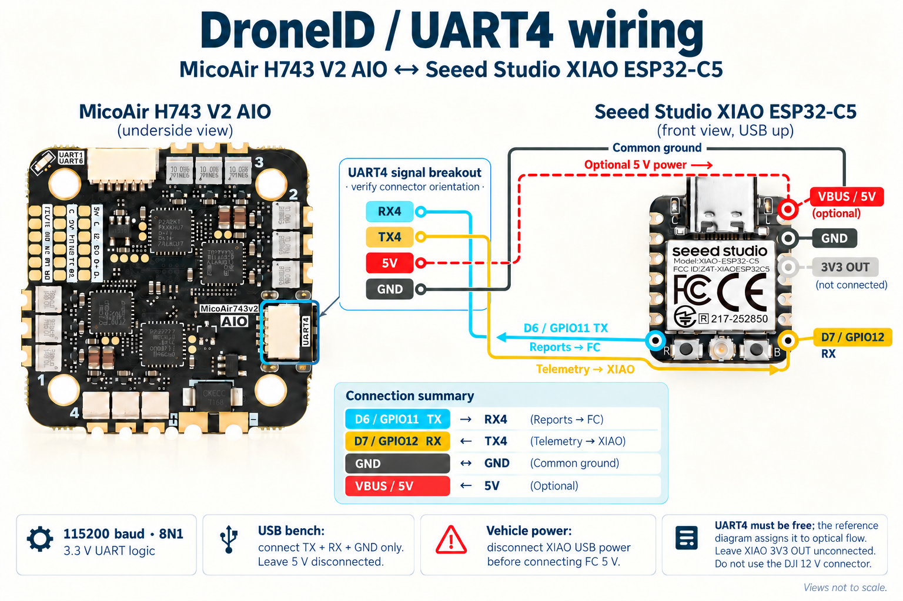
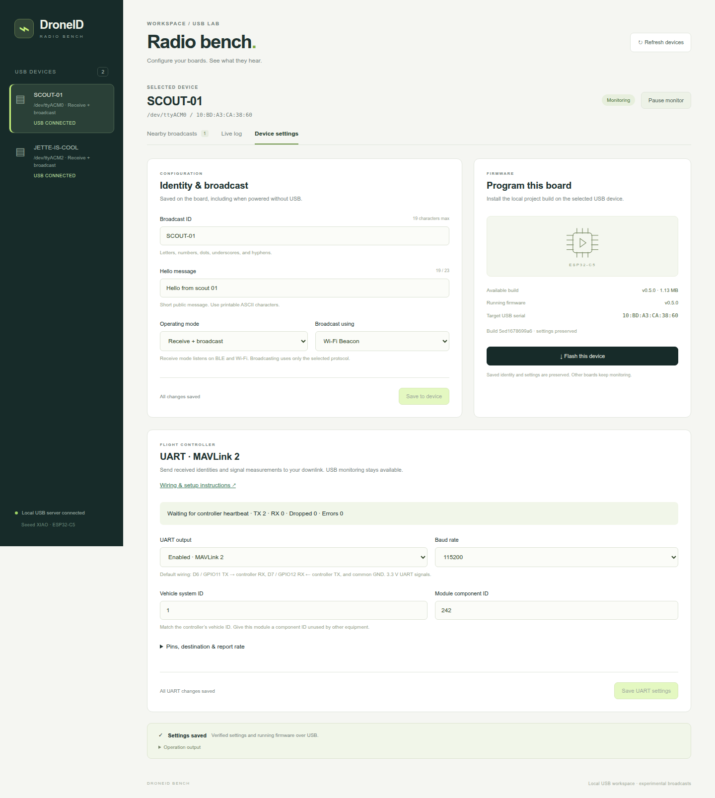

# DroneID

ESP-IDF firmware for the **Seeed Studio XIAO ESP32-C5**. The current version
provides a USB bench setup for receiving and logging BLE and Wi-Fi Remote ID, with other
XIAOs acting as independently powered test transmitters. A local web dashboard
handles multiple USB boards, flashing, identity settings, and live reception.

> **Start here: [Open the web bench](#open-the-web-bench).** Use your browser to
> flash the local firmware build, set IDs and hello messages, and monitor nearby
> broadcasts with signal strength. Start with USB-connected boards; add the
> flight-controller UART connection when ready.

Firmware **0.5.2** fixes USB identification timing by driving the LED from an
independent timer, so USB traffic cannot stall the flashes. Introduced in 0.5.1, the web bench’s **Identify** button
flashes the selected board’s user LED rapidly for five seconds.

Firmware **0.5.0** adds a configurable UART/MAVLink 2 interface for forwarding
observations through a flight controller to a custom base-station parser.
USB remains versioned JSONL. The first controller target is the **MicoAir H743
V2 AIO**, using UART4 in the example below. Physical wiring and end-to-end
forwarding still need testing on the actual controller and installed firmware.

**Security:** read the [threat model](threatmodel/README.md) before connecting the
module to a flight controller. Received IDs are unverified claims; the model
covers radio interference, ESP32 compromise, the UART trust boundary, and the
web bench, with a prioritized hardening plan and reproducible offline checks.

**P0 containment offers two alternatives:** use the [FC UART4 filter](fc_filter/README.md)
with **one radio XIAO and custom FC firmware**, or insert a
[second XIAO UART guard](guard/README.md) and retain stock FC firmware.
Using both is optional. The FC option accepts the radio's existing UART reports
directly; no intermediate board is required. See the
[deployment diagram](fc_filter/topology.svg). **P0 is partially closed, pending full validation**; hardware, FC/downlink and power-fault acceptance remain open. Resume with the [P0 verification plan](threatmodel/p0-verification-plan.md); results are tracked in the [P0 closure checklist](threatmodel/p0-acceptance.md).

In the web bench, open **Device settings** and choose **Scout** or **Guard** for the selected board. Scout provides radio features; Guard provides firmware installation, USB checks and wired UART tests for C5, C6 and S3 profiles. See [supported XIAO guards and setup](guard/README.md#supported-xiao-models).

## Flight-controller wiring and UART setup

Setup links: [ESP32](#configure-the-esp32) ·
[ArduPilot](#ardupilot-on-the-micoair--uart4--serial4) ·
[iNav](#inav-on-the-micoair--uart4-bench-input) ·
[Connection checks](#check-the-connection) · [Troubleshooting](#uart-troubleshooting).

**Choose the wiring for your security option.** The direct wiring below connects
one radio XIAO to the [custom FC filter](fc_filter/README.md#build-and-install-in-an-fc-source-checkout).
For the external guard option, use the [two-XIAO wiring table and SVG](guard/README.md#connection);
no FC filter patch is required. Direct radio wiring to stock FC firmware has
neither boundary. The stock controller settings below establish connectivity;
they do not install the FC-side filter.

Use a free, **non-inverted, full-duplex UART with 3.3 V logic** on the controller.
The XIAO uses hardware UART1 independently of its USB connection. Pin names
below are the **XIAO's printed D labels**, followed by ESP32 GPIO numbers.

| XIAO ESP32-C5 connection | Flight controller connection | Direction |
| --- | --- | --- |
| **D6 / GPIO11 — TX** | Selected UART **RX** | Remote ID reports → controller |
| **D7 / GPIO12 — RX** | Same UART **TX** | Controller telemetry → XIAO |
| **GND** | **GND** | Common signal ground |
| **5V / VBUS** — vehicle power only | Verified regulated **5 V** supply | Power to XIAO |



[Open the full-size wiring illustration](docs/images/micoair-xiao-uart4.png).
The enlarged UART4 block identifies **signals**, not cable-end pin numbers.

**For the first bench connection, power the XIAO from USB and connect only TX,
RX, and GND to the powered controller. Leave the 5 V wire disconnected.** For
vehicle power with USB unplugged, use a regulated 5 V rail with sufficient spare
current for Wi-Fi bursts. Verify the controller's rail rating before choosing it.
Do not connect raw flight-battery voltage, a 9/12 V peripheral rail, or 5 V logic
to the UART pins. The XIAO **3V3 pin is an output**; leave it unconnected in this
wiring. Make connections with power removed. Do not attach two TX outputs
together or use an inverted SBUS pad as a normal UART.

The D6/D7 mapping and power-pin roles come from
[Seeed's pin map](https://wiki.seeedstudio.com/xiao_esp32c5_getting_started/#pin-map).
The [ESP32-C5 electrical specifications](https://files.seeedstudio.com/wiki/XIAO_ESP32C5/res/esp32-c5_datasheet_en.pdf)
define the GPIO signal levels. For the selected controller, use the following
board-specific example and confirm the connector orientation against its manual.

### MicoAir H743 V2 AIO example — UART4

Use the **white UART4 connector on the underside**, at the lower-right edge in
the supplied board photograph. The supplied manufacturer wiring diagram labels
its signals **RX4, TX4, 5V, GND**. It assigns this connector to an optical-flow
sensor: **this example requires UART4 to be free**. If that sensor is installed,
choose another free UART pair and adapt the controller's port settings; do not
join both peripherals to UART4.

| XIAO, front facing you with USB at the top | MicoAir UART4 signal | Wire in illustration |
| --- | --- | --- |
| Bottom-left pad: **D6 / GPIO11 TX** | **RX4** | Cyan: reports to FC |
| Bottom-right pad: **D7 / GPIO12 RX** | **TX4** | Amber: telemetry to XIAO |
| Second pad down on right: **GND** | **GND** | Graphite: common ground |
| Top-right pad: **VBUS / 5V** | **5V**, optional | Dashed red: vehicle power only |

The third right-hand XIAO pad is **3V3 OUT** and stays unconnected. The front and
back views mirror left/right; use the front view above when locating D6/D7.
Identify the connector's signal names before making a harness: a mating plug
view can reverse the apparent order. Do not infer pin numbers from wire colors
or the enlarged signal block.

The [manufacturer's V2 AIO page](https://micoair.com/flightcontroller_micoair743v2_aio_35a/)
lists a **shared 5 V / 2 A rail** for the controller and peripherals, and a
separate **12 V DJI/VTX connector**. Check spare 5 V capacity before powering
the XIAO. The supplied diagram is labelled **45A** while that current product
page is **35A**; verify the connector labels and supply rating on your board
revision. The illustration uses the family name without an ESC current rating.

The manufacturer's firmware targets are **`MicoAir743v2` for ArduPilot** and
**`MICOAIR743V2_EXTMAG` for iNav**. Use the V2 target matching the actual board,
not the earlier MicoAir743-AIO target. In the checked
[ArduCopter 4.6.3 board definition](https://github.com/ArduPilot/ardupilot/blob/Copter-4.6.3/libraries/AP_HAL_ChibiOS/hwdef/MicoAir743v2/hwdef.dat),
physical UART4 maps to **`SERIAL4`**; TX4 is PA0 and RX4 is PA1. Those STM32 names
describe the FC; the XIAO remains GPIO11/GPIO12.

### Configure the ESP32

Flash the current build, then open **Device settings → UART · MAVLink 2** in
the web app. Enable UART and save. Settings persist separately from the broadcast
ID/hello settings, and saving either group preserves the other.

| Setting | Default |
| --- | --- |
| UART enabled | **No** — enable after selecting the intended wiring |
| Serial format | **115200 baud, 8 data bits, no parity, 1 stop bit** |
| Electrical signaling | Full duplex, non-inverted, no RTS/CTS |
| TX / RX GPIO | **11 / 12** — D6 / D7 |
| Vehicle MAVLink system ID | **1** — match the controller |
| Module component ID | **242** — must be unused on that vehicle |
| Controller component ID | **1** — expected telemetry source |
| Base-station destination | **System 255, component 190** |
| Maximum observations sent | **5 per second**, configurable 1–50 |

The UI can change baud rate, pins, source/destination IDs, and report rate. CLI
equivalent, with that board's web monitor paused:

```sh
python tools/bench.py uart --port /dev/ttyACM0 --enable --baud 115200 --tx-pin 11 --rx-pin 12 --system-id 1 --component-id 242 --fc-component-id 1 --target-system 255 --target-component 190 --max-rate 5
```

Use `--disable` instead of `--enable` to disable UART. The CLI supplies defaults
for omitted fields, so include your changed settings when disabling if you want
to preserve them. The web form preserves all displayed fields. Baud choices:
57600, 115200, 230400, or 460800. Pin choices are limited to XIAO D0–D10; TX and
RX must differ and must be free of other attached peripherals.

D6/GPIO11 is also the chip's default ROM UART TX pin. Reset/startup may produce
a ROM banner there before the application takes over; the receiving MAVLink
parser must tolerate startup bytes and resynchronize. Application logs stay off
this UART. Disabling the application UART does not suppress ROM output.

### What travels over UART

- Outbound: a component heartbeat every second and standard MAVLink 2 `TUNNEL`
  messages containing versioned DroneID observation/health records. Observations
  retain **RSSI, transport, channel, source address, boot session, sequence,
  receive/report times, and all 25 raw Remote ID message bytes**.
- Inbound: the configured controller's `HEARTBEAT`, `GLOBAL_POSITION_INT`, and
  `GPS_RAW_INT` are monitored. A heartbeat expires after five seconds. Position
  and GPS fields have separate ages and become unavailable when stale.
- USB keeps its existing JSONL stream, plus UART configuration, health counters,
  and fresh controller telemetry in status. A bounded UART queue and nonblocking
  UART writes keep radio reception and USB independent of downlink congestion.

The incoming position is currently diagnostic input; it does **not yet feed
own-aircraft Remote ID broadcasts**. This build does not implement MAVLink
signing, MSP, flight commands, or a compliant aircraft-position transmitter.
Signed input is ignored. See the [wire contract](docs/uart-protocol.md) for exact
payload layouts, rate limits, and base-station integration.

### Controller and base-station connection

The controller must route observations onto the existing MAVLink 2 downlink.
These examples were checked against source and documentation; **end-to-end
hardware compatibility remains unverified**. Record the installed FC version
when testing; the examples do not assume a version is already flashed.

| Firmware | Controller telemetry into XIAO | DroneID reports through FC to base station |
| --- | --- | --- |
| ArduPilot | MAVLink 2 on UART4 | Supported routing mechanism; verify delivery with the installed build/downlink |
| iNav 9.0.0 | MAVLink telemetry on UART4 | Requires an iNav extension or telemetry gateway; settings alone do not enable forwarding |

Start with the three-wire USB-powered bench connection above and the XIAO UART
enabled at **115200, TX GPIO11, RX GPIO12**. The instructions below configure
the existing FC firmware; they do not require reflashing or a factory reset.

#### ArduPilot on the MicoAir — UART4 / SERIAL4

The concrete parameter example is based on **ArduCopter 4.6.3, MicoAir743v2**.
For other ArduPilot vehicle types/builds, confirm the available parameters and
port mapping. Forwarding-option changes in 4.7+ are listed below.

1. Connect the **flight controller's USB** to Mission Planner and connect to
   its port. Open **CONFIG → Full Parameter List** (called **CONFIG/TUNING** in
   some versions). Choose **Save to file** to keep the existing configuration.
2. Search for `SERIAL4`. Confirm UART4 has no optical-flow sensor or other
   peripheral, then enter the three values below. This UART is dedicated to
   the XIAO.
3. Click **Write Params**, reboot the FC, reconnect, and **Refresh Params** to
   confirm the saved values. These controls are described in
   [Mission Planner's parameter guide](https://ardupilot.org/planner/docs/mission-planner-configuration-and-tuning.html#full-parameter-list).

```text
SERIAL4_PROTOCOL = 2    # MAVLink 2
SERIAL4_BAUD     = 115  # 115200 baud
SERIAL4_OPTIONS  = 0    # Normal, non-inverted, full-duplex UART
```

The block describes parameter values, not commands to paste into a shell.

4. Read the FC vehicle system ID: `SYSID_THISMAV` on 4.6; newer builds may
   expose it as [`MAV_SYSID`](https://github.com/ArduPilot/ardupilot/blob/master/libraries/GCS_MAVLink/GCS.cpp).
   Set the **XIAO's vehicle system ID** to that existing value. This module
   supports IDs 1–255. Keep controller component **1** and use module component
   **242** if it is unused. The broadcast DroneID string is a separate identity.
   With the independent guard, retain sensor component **242** and reserve
   **243** for the guard; the FC sees the guard's regenerated reports from 243.
5. On the FC's **existing telemetry-radio port**, select MAVLink 2
   (`SERIALn_PROTOCOL=2`) and keep the baud rate required by that radio. For
   example, a radio on UART1 uses `SERIAL1`; a 57600-baud radio uses
   `SERIAL1_BAUD=57`. This does not change the XIAO's 115200-baud UART4 link.
6. Confirm forwarding is enabled on both ports using the table below, then
   write any changes and reboot. Run the base-station receiver with IDs
   matching the XIAO destination, initially **255/190**. Its heartbeat must
   travel back through the downlink so ArduPilot can learn the destination.

| ArduPilot version | Forwarding option to check on each participating link |
| --- | --- |
| Through 4.6 | `SERIALn_OPTIONS`: bit 10 (`1024`, disable forwarding) must be clear |
| 4.7 and later | Matching `MAVx_OPTIONS`: bit 1 (`2`, disable forwarding) must be clear |

ArduPilot's [routing rules](https://ardupilot.org/dev/docs/mavlink-routing-in-ardupilot.html)
and [serial options reference](https://ardupilot.org/copter/docs/common-serial-options.html)
describe this behavior. Preserve unrelated option bits on the existing downlink.
A `MAVx` index is not necessarily the physical UART number: do not assume
`MAV4_OPTIONS` controls UART4. Any existing GCS-ID restrictions must permit the
receiver's chosen ID. Use normal MAVLink routing for this link; leave serial
passthrough disabled. The XIAO currently uses unsigned MAVLink and ignores signed
input, so a link requiring signed traffic needs signing support added first.

**Optional position/GPS stream setup:** the XIAO does not request message
rates. In the checked 4.6.3 build, configure the `SRx_POSITION` and
`SRx_EXT_STAT` groups for the XIAO's MAVLink channel to **2 Hz**, then write
parameters and reboot. These groups include `GLOBAL_POSITION_INT` and
`GPS_RAW_INT`, respectively, in
[ArduCopter's stream definitions](https://github.com/ArduPilot/ardupilot/blob/Copter-4.6.3/ArduCopter/GCS_Mavlink.cpp).

Determine the channel from the configured MAVLink ports, counting from zero
in serial-port order. For example, **only if SERIAL0, SERIAL1, and SERIAL4 are
the first three MAVLink ports**, they use channels 0, 1, and 2; set
`SR2_POSITION=2` and `SR2_EXT_STAT=2` for the XIAO. Changing SERIAL2 from
DisplayPort to MAVLink would change that index. The
[4.6.3 channel initialization](https://github.com/ArduPilot/ardupilot/blob/Copter-4.6.3/libraries/GCS_MAVLink/GCS_Common.cpp)
assigns channels from MAVLink protocol instances, not UART numbers.

For a build using different stream-parameter names, ArduPilot also supports a
per-channel file on the SD card. After identifying channel **N**, put these
two lines in the card's root file **`message-intervals-chanN.txt`**, preserving
any other needed entries in an existing file, and reboot:

```text
33 500
24 500
```

Here `N` is replaced with the actual channel number; `500` is milliseconds
(2 Hz). The [message-rate documentation](https://ardupilot.org/dev/docs/mavlink-requesting-data.html)
describes the file format and channel numbering. Heartbeat is sent separately.
Valid position/GPS data also requires the corresponding FC sensor/navigation
data; these settings do not create a GPS fix.

#### iNav on the MicoAir — UART4 bench input

This procedure uses **iNav 9.0.0, MICOAIR743V2_EXTMAG** as a reference. It enables
**controller telemetry into the XIAO**. Source inspection shows no stock path
for forwarding this module's TUNNEL reports to another port. If the existing
downlink already uses iNav's one MAVLink telemetry output, keep it allocated
there and plan a gateway or firmware extension before adding this UART4 profile.

**Security boundary:** the reference iNav telemetry port also processes incoming
MAVLink. “Telemetry Output” does not make it read-only. See the
[FC threat analysis](threatmodel/threat-register.md#tm-04--compromised-esp32-pivots-into-the-flight-controller)
and [one-way wiring or guard options](threatmodel/hardening-plan.md#p0--contain-the-flight-controller-boundary).

1. Connect the **FC USB** to the matching iNav Configurator. In **CLI**, run
   `version` and `diff all`; save the output with the current configuration.
   Leave CLI and open **Ports**.
2. On the **UART4** row, choose the settings below. Use the **Telemetry Output**
   selector, not Serial RX or a MAVLink receiver option. Leave the USB/VCP row
   and the actual radio-control receiver port configured as they are.

| UART4 field | Setting |
| --- | --- |
| MSP / Configuration | Off |
| Serial RX | Off |
| Telemetry Output | MAVLink |
| Telemetry baud | **115200**, explicitly; do not leave AUTO |
| Sensor input / Peripherals | None on UART4 |

3. Click **Save and Reboot**. Reconnect, open **CLI**, and apply the following
   example. It assumes vehicle system ID **1**; if the aircraft already has
   another ID, retain it here and match the XIAO to it.

```text
feature TELEMETRY
set mavlink_version = 2
set mavlink_sysid = 1
set mavlink_pos_rate = 2
set mavlink_extra2_rate = 2
save
```

4. After reboot, leave CLI closed. The dedicated telemetry port can operate
   while disarmed. Open the XIAO dashboard and check for **Controller heartbeat
   received**, with UART RX counts increasing. Use controller component ID
   **1**, distinct from the module's **242**.

The [iNav telemetry guide](https://github.com/iNavFlight/inav/blob/9.0.0/docs/Telemetry.md)
describes enabling telemetry and reserving a port. The
[versioned settings](https://github.com/iNavFlight/inav/blob/9.0.0/src/main/fc/settings.yaml)
define the CLI names. In the
[MAVLink implementation](https://github.com/iNavFlight/inav/blob/9.0.0/src/main/telemetry/mavlink.c),
`mavlink_extra2_rate` controls the group containing heartbeat, and
`mavlink_pos_rate` controls GPS/position output when a GPS source is available.
AUTO baud selects 57600 in this version. A second MAVLink telemetry port does
not establish forwarding. Unknown CLI settings on another version are a reason
to check that version's documentation, not assume the command succeeded.

There is no stock iNav CLI setting that completes the DroneID return path.
Until a gateway or forwarding extension is implemented, use **XIAO USB** to
observe received IDs/messages/RSSI during the iNav telemetry test. Betaflight
remains unvalidated.

#### Receive and verify at the base station

The supplied base-station receiver prints JSONL from a serial adapter or UDP
downlink. It sends a GCS heartbeat to establish the return route. Match its IDs
to the module's destination, and use IDs that do not collide with another GCS.

For the **first ArduPilot forwarding test**, the FC's own USB connection can
replace the telemetry radio. Keep `SERIAL0_PROTOCOL=2`, disconnect Mission
Planner from that port, and run the receiver against the **FC's actual USB
port**. `/dev/ttyACM1` below is only an example; identify the FC before using it.
The XIAO can remain connected to the dashboard through its own USB port.

```sh
python -m pip install -r tools/requirements-mavlink.txt
python tools/mavlink_receiver.py --connect /dev/ttyACM1 --baud 115200 --system-id 255 --component-id 190 | tee received-uart.jsonl
```

This tests **XIAO UART → ArduPilot → FC USB → receiver**. The XIAO USB socket
itself is JSONL and cannot be used as that binary MAVLink endpoint. Once this
passes, repeat over the existing base-station downlink:

```sh
python tools/mavlink_receiver.py --connect udpin:127.0.0.1:14550 > received-uart.jsonl
# Or, directly from a 3.3 V USB-to-UART adapter:
python tools/mavlink_receiver.py --connect /dev/ttyUSB0 --baud 115200
```

For UDP, arrange for the existing telemetry bridge to send to that address and
carry the receiver's heartbeat back to the FC; the command does not create a
radio bridge. A serial telemetry radio can instead be opened by its actual
device path with `--baud` set to the radio's baud rate. If Mission Planner and
the parser share one radio, use a MAVLink router with separate endpoints and
unique GCS identities; do not open the same serial port twice. Match the XIAO's
destination IDs to the parser's `--system-id` and `--component-id`. Keep its
heartbeat enabled; `--passive` disables the route-learning heartbeat.

For the adapter test, use **adapter RX ← XIAO D6**, **adapter TX → XIAO D7**,
and **GND ↔ GND**. Keep the adapter's power pin disconnected while the XIAO is
USB-powered. The board's own USB socket carries JSONL, not this binary MAVLink
stream; `/dev/ttyUSB0` above is the separate UART adapter.

Power another configured broadcaster. Confirm ID/hello records and RSSI reach
the receiver tool. In the web app, UART TX counts should increase. The tool's
GCS heartbeat proves serial RX activity but does not count as a controller
heartbeat; **Waiting for controller heartbeat** is expected until a controller
with the configured source IDs sends one. Repeat through the real controller
and downlink before relying on forwarding. UART TX counts indicate bytes queued
to the peripheral, not acknowledgement by the controller or base station.

#### Check the connection

1. In **Device settings → UART · MAVLink 2**, expect **Controller heartbeat
   received** and increasing RX/TX frame counts. This works with the FC disarmed.
   In a USB status record, `uart.enabled`, `uart.ready`, and `uart.connected`
   should be true, with `uart.heartbeat_age_ms` normally below 2000.
2. If GPS/position streaming is configured, inspect `uart.position_age_ms`,
   `uart.gps_age_ms`, `uart.position`, and `uart.gps` in **Live log**. A fresh
   heartbeat alone does not establish a GPS fix. Fields expire after five seconds;
   absent position data does not prevent nearby Remote ID reports.
3. For ArduPilot forwarding, the receiver should print `"kind":"uart_health"`
   records roughly every two seconds even without another broadcaster. JSON
   whitespace may differ. That proves report delivery through the tested path.
4. Power a second board in `tx` or `both` mode with a distinct broadcast ID.
   Configure the receiving XIAO as `rx` or `both`. Expect `observation` records
   with `broadcast_id` or `hello`, `rssi_dbm`, and `raw_message_hex`, alongside
   health records. Ordinary Mission Planner/QGroundControl maps do not decode
   this custom payload; use the supplied receiver or your base-station parser.
5. Power-cycle the XIAO and FC and confirm settings persist and reports resume.
   On stock iNav, steps 3–4 use the XIAO USB JSONL log until forwarding is added;
   the `uart_health` record check specifically applies to the MAVLink receiver.

#### UART troubleshooting

| Symptom | Check |
| --- | --- |
| UART disabled or initialization failed | Firmware 0.5.0+, UART enabled/saved, distinct supported GPIO11/12 pins; inspect `uart.errors` |
| TX rises, RX stays at zero | FC TX4 → XIAO D7, common GND, FC power, both ends at 115200, intended UART enabled |
| RX rises but no controller heartbeat | Vehicle system/component IDs, `uart.signed_ignored`, and heartbeat output; a GCS heartbeat is not an FC heartbeat |
| iNav sends no telemetry while disarmed | Dedicated UART4 with MSP/Serial RX off, `feature TELEMETRY`, nonzero `mavlink_extra2_rate`, CLI closed, explicit baud |
| Heartbeat works; GPS/position is null | Appropriate stream rates on the XIAO channel, GPS availability and field ages; do not confuse channel index with UART number |
| USB shows observations but base station gets no health/reports | MAVLink 2 on every hop, correct destination IDs, return heartbeat, routing flags, message filtering, and whether stock iNav is in the path |
| Parse errors keep rising | Baud mismatch, inverted/incorrect pads, wiring/ground quality, or another peripheral sharing the UART; startup ROM bytes can cause a transient error |
| `queue_drops` / `expired` increase | Reduce the XIAO report rate or offered traffic and check UART throughput; FC/downlink losses can occur without these local counters increasing |

Keep the installed firmware version, port settings, and a received log with the
bench test results. The procedures above remain unverified on the physical
MicoAir until this test is performed.

## Current features

| Role | Behavior |
| --- | --- |
| `rx` (default) | Alternate BLE and Wi-Fi listening windows; stream observations over USB |
| `tx` | Broadcast experimental Basic ID and Self ID using one selected transport |
| `both` | Receive both protocols and broadcast using the selected transport |

The saved broadcast setting is **`wifi` by default**, or `ble`. Wi-Fi transmission
uses Beacon frames on channel 6. Selecting a broadcast transport never disables
the other receive protocol in `rx` or `both`; there is no dual-transport broadcast
setting. `both` means receive plus transmit, not two transmit transports.

Roles, broadcast IDs, hello messages, and transports are saved in NVS and survive a power cycle. Test transmitters therefore
work from a USB power supply after configuration. Every received packet includes
RSSI in dBm, source address, receiver ID, boot session, receive time, message
counter, decoded data, and raw bytes. Bounded queues and USB timeouts keep radio
work independent of the connected computer.

Reception supports **BLE legacy, Wi-Fi Beacon, and Wi-Fi NAN**. The C5 schedules
300 ms each on Wi-Fi channels 6 and 149 in randomized order, then 400–500 ms on BLE.
It cannot hear every protocol/channel continuously. BLE extended/coded-PHY,
Wi-Fi NAN transmission, and live own-aircraft telemetry remain future work.
Test broadcasts contain no fabricated flight position and do not constitute a
complete or compliant Remote ID transmitter.

## Build and flash

Open this folder in VS Code with Espressif's ESP-IDF extension. The project uses
**ESP-IDF v6.1**, **CMake 3.22+**, and target **esp32c5**.

In an ESP-IDF terminal:

```sh
idf.py set-target esp32c5
idf.py build
idf.py -p /dev/ttyACM0 flash
```

Select each board's actual port. On Linux, `/dev/serial/by-id/...` paths are
preferable when multiple boards are connected. Flash the same image to every
board. Application version: `0.5.2`; flash size: 8 MB; PSRAM is not needed.
The custom partition table provides a 2 MB app partition and preserves the old
NVS/PHY addresses. Flash the partition table as well as the app when upgrading.

USB remains the primary console to retain ESP-IDF's C5 revision 1.0 reset
workaround. Ordinary boot/application logs are disabled; JSON records use the
USB Serial/JTAG driver directly. A short ROM banner can still precede records.
The user LED pulses every two seconds while the USB worker runs.

## Open the web bench

The web bench is the starting point for configuring and testing one or more
USB-connected XIAOs. Select a board, flash the local build, and configure its
identity and radio settings from your browser.



[View the full-size dashboard screenshot](docs/images/web-bench.png).
Shown: **Device settings**. **Nearby broadcasts** is the default view for
received IDs, messages, and signal strengths; **Live log** shows the USB stream.

In an ESP-IDF terminal, after [building the firmware](#build-and-flash):

```sh
python -m pip install -r tools/requirements.txt
./start-web
```

Open **http://127.0.0.1:8766**. Select a connected board in the sidebar. The
default view shows nearby broadcast IDs, hello messages, and measured signal
strength. **Live log** shows its USB JSONL stream; **Device settings** lets you
flash the local build and save an ID, hello message, role, and broadcast transport.
Other boards keep monitoring while the selected board is programmed.

The Linux launcher stops any existing web server from this checkout before
starting a fresh one. It also finds servers started directly with `tools/server.py`.
Run `./start-web --port 8767` to choose a different port; Ctrl+C stops the server.
Use your activated Python environment with the dependencies installed.

Close other serial monitors before starting the server. Use `--port 8767` if
8766 is occupied. See the [web bench guide](docs/web-bench.md) for first-time
setup, limits, and recovery.

### Scout and Guard roles

In **Device settings**, choose the selected device's **Scout** or **Guard** role.
The controls follow that choice. Role selection alone does not flash or change the
board; use **Install Scout firmware** or **Install Guard firmware** to apply it.
Scout supports C5; Guard has C5, C6 and S3 firmware profiles. It includes a model catalog, local build checks, per-board
flash output, a USB/startup-policy check and an optional two-adapter UART smoke
test. See [build profiles, pin mappings and fixture instructions](guard/README.md#web-bench-flash-and-test-guards).
Hardware acceptance remains pending. The FC software filter remains an
alternative to the separate guard board.

## Use the USB command-line bench

Install the Python dependency in your chosen environment, or use ESP-IDF's
Python environment, which already includes pyserial in this setup.

```sh
python -m pip install -r tools/requirements.txt
python tools/bench.py list
python tools/bench.py role rx --port /dev/ttyACM0
python tools/bench.py role tx --port /dev/ttyACM1
python tools/bench.py transport wifi --port /dev/ttyACM1
python tools/bench.py monitor --port /dev/ttyACM0 --output received.jsonl
```

The port names above are examples. `role` restarts the selected board after
saving the setting. Close any other serial monitor before using these commands.
Use `monitor --json` for machine-readable stdout and `--duration 30` for a timed
capture. Logs are appended, not overwritten.

Use `python tools/bench.py transport ble --port /dev/ttyACM1` to select BLE
broadcasting. The setting is saved and the board restarts. Upgrading from 0.2.0
preserves the role and selects Wi-Fi when no transport setting exists.

Use `python tools/bench.py configure --port /dev/ttyACM0 --role both --transport wifi --id SCOUT-01 --hello "Hello from scout 01"`
to save all settings together. Pause that board's web monitor before using the
CLI. See the [USB bench guide](docs/usb-bench.md) for the record schema, offline
behavior, commands, and measurement limitations.

## Validation

```sh
bash tests/run_host_tests.sh
```

Host tests exercise fixed packets, malformed/truncated advertisements, binary
IDs, JSON escaping and bounds, unknown values, and stream recovery. Wi-Fi tests
include frames generated by upstream OpenDroneID, nested length mutations, and
all truncation points. C tests use AddressSanitizer and UndefinedBehaviorSanitizer
with 10,000 BLE and 10,000 Wi-Fi arbitrary-payload trials.
Dashboard tests cover aggregation, independent field ages, configuration limits,
firmware selection, concurrent port ownership, and local HTTP access controls.
UART tests check the official MAVLink parser against independent pymavlink
fixtures, corrupted/truncated frames, source filtering, signed input rejection,
freshness, and a million random input bytes under sanitizers. Install
`tools/requirements-mavlink.txt` to also run the Python reference-decoder test.
Firmware 0.5.0 passed both C sanitizer suites and all 18 Python tests, including
the reference decoder. The original board was flashed and checked for UART
initialization/TX progress, persisted settings, and concurrent USB/radio operation.
The browser controls and a local UDP receiver test passed. External UART signal
capture and an actual controller/downlink round trip remain to be tested.
Hardware verification results are recorded in the USB bench guide.

The independent guard adds a third C sanitizer suite for its allowlist, schema,
frame-boundary recovery, bidirectional policy and work/rate budgets. Reference
pymavlink tests decode its DRG2 reports through the base-station helper.
See [guard validation and remaining acceptance](guard/README.md#validation-and-remaining-acceptance).
Three further C/C++ sanitizer suites exercise the FC policy, direct-radio input
and actual receive adapters, including signature rejection and report-only routing.
The installer tests verify safe refusal of changed source, board or policy files.
See [FC filter verification](fc_filter/README.md#verification-and-acceptance).

## Project structure

| Path | Purpose |
| --- | --- |
| `main/app_main.c` | Boot, persistent settings, USB commands, status, and packet reporting |
| `main/ble_radio.c` | BLE scanning and experimental advertising |
| `main/wifi_radio.c` | Wi-Fi capture, channel selection, and bench Beacon transmission |
| `main/radio.c` | Receive scheduling and exclusive broadcast transport selection |
| `main/fc_uart.c` | Independent UART1 worker, bounded queue, rate limits, and health |
| `components/fc_link/` | Portable UART configuration and MAVLink adapter |
| [Independent UART guard](guard/README.md) | Separate radio-free firmware project for a second XIAO between sensor and FC |
| `components/uart_guard/` | Portable guard policy, bounded parsing and regenerated MAVLink output |
| [FC UART filter](fc_filter/README.md) | Independent FC ingress policy, pinned ArduPilot/iNav patches, installer and portrait topology |
| `components/mavlink/` | Pinned official MAVLink common C headers |
| `components/rid/` | Portable advertisement framing and observation serialization |
| `components/opendroneid/` | Pinned upstream codec, license, and documented local changes |
| `tools/bench.py` | Device listing, identity/role configuration, and host logger |
| `tools/mavlink_receiver.py` | Base-station TUNNEL decoder and serial/UDP logger |
| `tools/server.py`, `tools/dashboard.py` | Local HTTP service, independent USB readers, flash/configuration jobs |
| `web/` | Browser dashboard; plain HTML, CSS, and JavaScript |
| `tests/` | Portable codec/stream tests |
| [Threat model](threatmodel/README.md) | Security boundaries, threat register, hardening priorities and offline evidence |
| [Project definition](docs/project-definition.md) | Overall scope and development milestones |
| [Flight-controller integration](docs/flight-controller-integration.md) | Planned UART/MAVLink interface |

The selected device’s **Identify** button flashes its user LED rapidly for five seconds over USB, then restores the normal heartbeat. Flash the current firmware to enable it.
