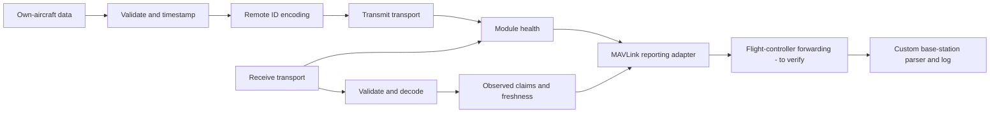

# DroneID project definition

Status: updated 2026-10-23. Firmware 0.5.0 implements the
[USB bench mode](usb-bench.md), with BLE/Wi-Fi reception, RSSI reporting, persistent
IDs, hello messages, roles, and one configurable transmit transport (Wi-Fi by default).
The [local web bench](web-bench.md) supports multiple USB devices with flashing,
configuration, a graphical reception view, and optional live logs.
The ESP32-side UART/MAVLink adapter is implemented; controller-specific routing
and wiring verification remain pending. See the [UART contract](uart-protocol.md)
and the [README wiring guide](../README.md#flight-controller-wiring-and-uart-setup).

## Objective and confirmed choices

Create one hardware package that can broadcast its own aircraft's Remote ID
and receive nearby broadcast Remote ID messages. The intended host is a patrol
drone operating in the **United States**. The user has clarified "IFF" to mean
logging nearby aircraft and reporting the observations to a base station and
operator.

Confirmed hardware: Seeed Studio XIAO ESP32-C5 and **MicoAir H743 V2 AIO** as
the first flight-controller target. The README illustrates its UART4 connection.
Confirmed development approach:
ESP-IDF, C, and VS Code. The local ESP-IDF v6.1 installation builds the firmware.

The flight-controller connection is **UART**, with **iNav** as the initial
preference and **ArduPilot**, possibly **Betaflight**, as alternatives. The
downlink already carries a larger telemetry stream using **MAVLink**. Custom
software at the base station will parse and log the Remote ID observations.

Initial development scope: bench testing of identity broadcasts and observations,
with information shown to a human through a connected laptop. The intended
vehicle path and compatibility checks are in the
[flight-controller integration plan](flight-controller-integration.md).

## Identification model

Receiving a broadcast establishes that a message was observed. A claimed serial
number or an entry matching a local fleet list does not establish the physical
aircraft's identity or authorization. The IETF describes RID authentication,
spoofing, and replay as separate issues in its
[DRIP architecture](https://www.rfc-editor.org/rfc/rfc9434.html).

For the prototype, observations must retain their source and age. Any future
fleet-list match must be labelled as a match to a **claimed ID**. Authentication
would require an independently specified and validated trust mechanism; it is
not provided by decoding Basic ID messages.

No received message means no observation; it does not establish absence or
hostility. Remote ID reception alone cannot establish collision-free airspace.
The confirmed behavior is reporting to an operator; flight commands are outside
the current scope.

## Hardware feasibility

The board has dual-band Wi-Fi and BLE, with 8 MB flash and 8 MB PSRAM according
to [Seeed's board documentation](https://wiki.seeedstudio.com/xiao_esp32c5_getting_started/).
These capabilities do not by themselves establish support for every Remote ID
transport in the selected SDK.

Espressif documents a shared RF path, including 5 GHz Wi-Fi, with time-divided access.
Its C5 coexistence table marks Wi-Fi sniffer RX with BLE scanning or advertising
as supported with unstable performance. See
[Espressif's coexistence guide](https://docs.espressif.com/projects/esp-idf/en/latest/esp32c5/api-guides/coexist.html).
The same warning is present in the installed v6.1 coexistence documentation.

Consequently, combined TX/RX is a feasibility milestone, not an assumed
capability with continuous reception. Measure the effect of advertising,
channel selection, and other radio activity on reception. Dual-band capability
does not mean continuous reception on every Wi-Fi channel.

Start with one C5 for experiments. If measured behavior cannot meet the eventual
requirements, a single enclosure could contain separate transmit and receive
hardware. Hardware selection depends on the measurements.

## Protocol and telemetry choices

Integrated codec: [OpenDroneID Core C](https://github.com/opendroneid/opendroneid-core-c),
which implements encoding and decoding for ASTM F3411 / EN 4709-002 related
messages. Keep its wire codec behind a small adapter so that radio drivers and
application records can change independently. The revision and Apache-2.0 license
are recorded in [the vendored component](../components/opendroneid/UPSTREAM.md).

The bench firmware receives BLE legacy advertisements and Wi-Fi Beacon/NAN
message packs, using explicit listening windows on BLE and Wi-Fi channels 6/149.
It broadcasts either Wi-Fi Beacon on channel 6 (default) or BLE legacy, selected
independently from the receive configuration. BLE extended/coded PHY and Wi-Fi
NAN transmission remain unimplemented. Independent hardware interoperability
testing is still required; bench results do not establish complete coverage.

The operating country is the US. The intended transmitter category (add-on
broadcast module or integration into a Standard Remote ID aircraft) still needs
to be selected. This affects the required data, including takeoff versus control
station information. The FAA describes those alternatives and the accepted
Declaration of Compliance process in its
[Remote ID guidance](https://www.faa.gov/uas/getting_started/remote_id).
A successful prototype packet decode does not establish FAA compliance.

The transmitter needs real own-aircraft identity and telemetry. Its data source
must provide position, altitude with a defined reference, velocity, time,
validity, and any operator/takeoff information required by the selected profile.
The XIAO is not the position source. Initially use offline fixtures to exercise
encoding; the planned live source is the flight controller. Verify which required
fields its selected protocol actually supplies. Missing or stale input must
remain distinguishable
from valid zero values.

## Proposed software boundaries

These are architectural responsibilities, not one FreeRTOS task per row. Board
support, the core codec, scheduled BLE/Wi-Fi radio, and USB reporting are implemented for
bench testing. UART/MAVLink reporting and diagnostic controller input are also
implemented. Feeding that input into own-aircraft broadcasts and aircraft-record
aggregation remain future work; the bench stream reports individual messages
with receive times.

| Area | Responsibility |
| --- | --- |
| Board support | LED, console, confirmed pin assignments, hardware status |
| Own-aircraft input | Accept telemetry and identity; track source, validity, and freshness |
| Remote ID codec | Wrap upstream encoding/decoding and validate message lengths |
| Radio adapters | Implement each tested transport and report actual capabilities |
| Observations | Maintain bounded records of received claims and their timestamps |
| Flight-controller adapter | Read own-aircraft telemetry via MSP or MAVLink as supported by the selected firmware |
| Reporting interface | Deliver observations and module status through the MAVLink downlink to the custom base station |
| Diagnostics | Report queue drops, decode errors, input age, radio faults, and memory usage |

Radio callbacks should enqueue bounded work; decoding and host output run
outside callbacks. Backpressure must be observable. Reception must not be able
to exhaust memory or block required transmitter work. Combined mode must report
degraded reception rather than silently claiming full coverage.

Use monotonic receive timestamps for local age calculations. Preserve the
sender's claimed time separately. Track the age of individual data fields so
that a new identity packet cannot refresh an old position. A received ID and
radio address are claims, not guaranteed unique or stable keys. Duplicate IDs
must not silently collapse conflicting observations into a trusted aircraft.

## Development milestones

| Stage | Deliverable | Acceptance evidence |
| --- | --- | --- |
| 0: Board bring-up | Flashable C5 project, serial log, LED heartbeat | Successful SDK build; observed serial output and LED on the board |
| 0a: Downlink feasibility | Confirm the flight controller can carry component messages to the base station | A synthetic bench observation reaches the custom parser with identity and metadata intact, alongside normal telemetry |
| 1: Offline protocol | Pinned codec and recorded/synthetic fixtures | Reference vectors decode; malformed/truncated input is rejected; stale fields remain stale |
| 2: Receive experiment | One independently verified receive transport | A known transmitter is observed; protocol fields agree with an independent receiver; record age and drop counters behave correctly |
| 3: Transmit experiment | One independently verified transmit transport | An independent receiver decodes own-aircraft messages; missing/stale source data is handled explicitly |
| 4: Combined operation | Measured TX/RX behavior on the selected hardware | Compare receive-only and combined runs; record message gaps, TX intervals, drops, resets, and heap usage |
| 5: Vehicle integration | Complete telemetry-input and observation-output paths | Disconnect/reconnect, input loss, congestion, and restart behavior verified through the real flight controller and base station |

Use a second device or an independent transmitter/receiver to validate radio
behavior. One board decoding its own fixtures does not prove interoperability.
Choose quantitative latency, range, capacity, and availability criteria after
the actual operating requirements are supplied. A proposed combined-mode bench
run is 30 minutes, followed by longer tests once the initial behavior is known.

## Decisions still needed

1. Installed firmware/version and available UART on the MicoAir H743 V2 AIO.
   Verify wiring and forwarding; stock iNav needs an extension or gateway for
   this reporting path. The UART4 example assumes no optical-flow sensor there.
2. US transmitter category/profile and source of aircraft identity and any
   operator/takeoff information absent from the flight-controller telemetry.
3. MAVLink version and physical telemetry link, available bandwidth, message
   filtering, and the base-station parser's dialect/schema.
4. Which own-aircraft position/time fields the chosen firmware can provide.
5. Required compatibility beyond BLE legacy and Wi-Fi Beacon/NAN, and whether
   a separate authenticated fleet-identification requirement exists. Reception
   on both BLE and Wi-Fi is confirmed scope; transmission uses one selected transport.
6. Required range, update latency, number of simultaneous observations, and
   allowable reception gaps during transmission.
7. Power, weight, antenna placement, and whether more than one radio fits the
   final package.
8. Logging retention and behavior when the downlink is unavailable. Proposed
   first version: bounded RAM on the ESP32 and persistent logs at the base station.

USB bench testing can progress while these decisions are being resolved.
Flight-controller downlink feasibility remains the first vehicle integration gate.
