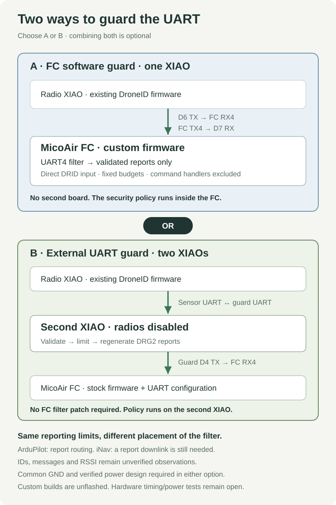

# FC UART ingress filter — standalone option

**A second XIAO is not required.** This option connects the radio XIAO directly
to UART4 on a flight controller running the custom FC filter. The alternative
is a [second XIAO hardware guard](../guard/README.md) between the radio and a
stock FC. Choose either; using both in series is optional.

| Deployment | Connection | Requirement |
| --- | --- | --- |
| FC software guard | Radio XIAO → filtered FC UART4 | One XIAO; custom FC firmware |
| External XIAO guard | Radio XIAO → guard XIAO → FC | Two XIAOs; no FC filter patch required |
| Optional combination | Radio XIAO → guard XIAO → filtered FC | Two XIAOs and custom FC firmware |

The FC option checks traffic inside the controller; the external guard limits
it before it reaches the controller. Both need hardware timing/power acceptance.
Neither authenticates aircraft claims.



This directory contains a portable C/C++ policy, actual source patches for
**ArduCopter 4.6.3 / MicoAir743v2** and **iNav 9.0.0 / MICOAIR743V2_EXTMAG**,
and a source-checking installer. These are custom development builds, not
features enabled by a stock serial-port setting. **No device has been flashed;
installed-FC behavior, flight-loop timing and electrical faults remain untested.**
See the [validation evidence](../threatmodel/evidence/p0-fc-standalone.json) for the
exact build/test results and hashes.

Local build artifacts, when present, are in `fc_filter/build/` (Git-ignored):
`arducopter-4.6.3-MicoAir743v2-droneid.apj` and
`inav-9.0.0-MICOAIR743V2_EXTMAG-droneid.hex`. These remain unflashed bench candidates.

## Port policy

| Input on protected UART4 | FC behavior |
| --- | --- |
| Radio or guard heartbeat | Validate, regenerate and count; never pass to GCS heartbeat/failsafe or command handlers |
| Direct radio DRID or external guard DRG2 observation/health TUNNEL | Validate original envelope/CRC, record metadata and budgets; normalize to DRG2; ArduPilot routes only after its normal unsigned-frame/signature policy also accepts the normalized frame |
| Commands, missions, parameters, RC overrides, sensor injection, FTP, other message types | Drop before the vendor MAVLink parser |
| Bad CRC, MAVLink 1, signed/unknown flags, wrong IDs/destination, unsupported record shape or encoding | Drop |
| Serial passthrough / alternate protocol on the protected port | Refused or bypassed by the dedicated receive path |
| Traffic on other physical ports | Existing FC receive behavior; retain authentication on the operator downlink |

ArduCopter's vehicle override normally calls avoidance/follow consumers before
the base routing function. The protected adapter explicitly calls the base
implementation, whose first action is the port gate, so those vehicle consumers
are bypassed too. The adapter regression test exercises this virtual-dispatch case.

**iNav does not forward these reports.** Its protected path validates/counts
then consumes them without invoking any ordinary inbound MAVLink handler. FC
telemetry still travels back directly to the sensor (or through an optional guard). Observation
delivery to the base station needs a separate iNav forwarding implementation or
gateway. Do not treat an accepted-input counter as operator delivery.

The same FC build accepts the radio's original binary **DRID** reports from
component **242**, or the optional external guard's **DRG2** reports from
component **243**. No second-board handshake or radio-firmware update is needed.
These are public format checks, not credentials, and share the same budgets.
A compromised radio/guard can fabricate or replay valid observations within
those limits. An allowed report has no flight-command authority.

Direct binary frames may contain `0xFD`/`0xFE` bytes, including complete nested
MAVLink commands. The FC quarantines the entire declared frame without restarting
inside it, validates its original CRC/schema, restores omitted trailing zeros,
and rejects hidden nonzero suffixes. It then encodes the record as DRG2 before
native parsing/routing, with a new sequence/CRC containing no interior start
markers. Original receiver/session/times/RSSI/raw RID are preserved. Source
component stays **242** for direct reports, **243** for external-guard reports.
Raw RID is never handed to a command parser or a flight-control/sensor input.

| Resource | FC policy |
| --- | --- |
| Quarantine buffer | 145 bytes, including full 128-byte TUNNEL array and framing; no dynamic allocation |
| UART reads per receive call | At most 128 bytes |
| Bytes admitted to quarantine | 4,096/s, burst 512; drops clear partial framing |
| Partial-frame gap / total time | 50 ms / 100 ms |
| Complete frames admitted to native parser/router | 800 bytes/s, burst 160, including framing |
| Message intervals | Heartbeat ≥1 s; observation ≥200 ms; health ≥2 s |
| Destination | Fixed base station system 255 / component 190; no broadcasts |
| Source | Vehicle system 1 / radio component 242 (DRID) or guard component 243 (DRG2); no FC impersonation |

Malformed bytes still incur bounded per-byte ingress work. UART/DMA interrupt
cost is outside this software budget and requires hardware timing tests. There
is no delivery guarantee; jitter or overload can drop otherwise valid reports.
Counters saturate and describe policy admission, not native signature acceptance
or downlink receipt. Inspect `droneid_filter` (ArduPilot) / `droneidFilter`
(iNav) in a debugger; no new remote diagnostic or configuration command is added.

## Build and install in an FC source checkout

For the standalone FC option, connect **radio D6/GPIO11 TX → FC RX4**,
**FC TX4 → radio D7/GPIO12 RX**, and common **GND**, using the
[direct wiring guide](../README.md#flight-controller-wiring-and-uart-setup).
Keep the existing radio firmware, enable its UART at 115200 with source 1/242,
FC 1/1 and destination 255/190, and install the FC patches below. There is no
intermediate board. For the optional combined deployment, use the
[second-XIAO harness](../guard/README.md#connection) instead.

The FC connection must use **UART4**, which is
**SERIAL4** on this ArduPilot board; a MAVLink *channel* index is not a physical
port number. The pinned board definition is checked by the installer.

Use isolated upstream checkouts and their normal build prerequisites. From
this repository, with the example checkout directories alongside it:

```sh
git clone --branch Copter-4.6.3 --recurse-submodules https://github.com/ArduPilot/ardupilot.git ../ardupilot-droneid
python3 fc_filter/install.py ardupilot ../ardupilot-droneid
python3 fc_filter/install.py ardupilot ../ardupilot-droneid --apply
python3 fc_filter/install.py ardupilot ../ardupilot-droneid --verify

git clone --branch 9.0.0 https://github.com/iNavFlight/inav.git ../inav-droneid
python3 fc_filter/install.py inav ../inav-droneid
python3 fc_filter/install.py inav ../inav-droneid --apply
python3 fc_filter/install.py inav ../inav-droneid --verify
```

The default installer invocation checks only. `--apply` checks the upstream
commit, original source hashes, board definitions and patch applicability before
writing. It refuses modified files, incompatible releases, symlinks in integration
paths and existing policy files. `--verify` checks the installed code against
this repository. It does not attest a binary or the firmware running on a board.

Build ArduPilot from its checkout:

```sh
./waf configure --board MicoAir743v2
./waf copter
```

Build iNav from its checkout:

```sh
cmake -S . -B build -DCMAKE_BUILD_TYPE=Release
cmake --build build --target MICOAIR743V2_EXTMAG -j4
```

Use the resulting custom firmware through the FC's normal maintenance process,
after verifying the actual board target and preserving its configuration. A
stock firmware update removes this FC-side policy. The ESP32 web bench does
not build or flash flight-controller firmware.

The pinned revisions are recorded in [manifest.json](manifest.json). Supporting
another release requires review of the receive, routing, serial allocation and
passthrough paths, new hashes/patches, and rerunning the checks. Do not force-apply
these patches to a different version. To change vehicle/destination IDs, edit
the constants in [droneid_fc_filter.h](droneid_fc_filter.h), match the radio's
settings (and external guard configuration if used), install into a fresh supported checkout, and rerun
the tests. UART4 is reserved by the integration code; changing only the header's
serial number does not port this profile to another UART.

## Controller configuration

**ArduPilot:** the custom build reserves physical SERIAL4 at MAVLink 2,
115200 baud and options 0 at boot. Protocol lookup keeps it reserved; attempting
to use it as GPS/RC/MSP or a serial passthrough endpoint is refused. The
SERIAL_CONTROL aliases for the same port are refused before locking/reading it.
Use the existing [ArduPilot telemetry configuration](../README.md#ardupilot-on-the-micoair--uart4--serial4)
to arrange FC→sensor position/GPS/heartbeat rates and the separate operator
downlink. Keep vehicle system 1 and base station 255/190 for this default profile.
The base station must announce itself on its normal downlink so the FC can
learn its route. Valid TUNNEL reports learn the radio/guard source route; its heartbeat
does not enter the ordinary FC handler or router.

**Signing is preserved.** Both supported inputs are unsigned frames; the native
ArduPilot parser may reject them under a signing-required configuration. This
integration does not add an unsigned exception, erase a key or disable signing.
If existing policy requires signed traffic, the present profile will fail closed
and needs an explicit compatible design before use. Do not lower the security of
the operator downlink to make the prototype connect.

**iNav:** configure UART4 for MAVLink telemetry using the existing
[iNav settings](../README.md#inav-on-the-micoair--uart4-bench-input), with system 1,
full duplex and 115200 baud. The custom build refuses other UART4 consumers,
forces normal 115200 8N1 operation when opening it, and emits MAVLink 2 on that
port. A wrong function assignment leaves the protected port unavailable instead
of exposing another parser. iNav still has a single MAVLink telemetry port;
protecting UART4 does not create a second one or a TUNNEL downlink.

## Verification and acceptance

P0 is partially closed, pending full deployment validation. Resume the
[verification plan](../threatmodel/p0-verification-plan.md); see the [P0 checklist](../threatmodel/p0-acceptance.md)
for the exact installed-FC, load/reset, downlink and power evidence still needed.

```sh
bash tests/run_host_tests.sh
python3 fc_filter/install.py ardupilot ../ardupilot-droneid --verify
python3 fc_filter/install.py inav ../inav-droneid --verify
bash fc_filter/test_ardupilot_headers.sh ../ardupilot-droneid
```

The host suite runs the portable policy and actual receive adapters with address
and undefined-behavior sanitizers. It covers common-dialect rejection, spoofed
sources, malformed/altered records, interior command frames, timeouts, byte
and message budgets, clock wrap, saturation, direct radio and guard interoperability, ArduPilot
signature rejection, report-only routing and independent physical ports. The
installer tests cover version/source/board/policy tampering and safe refusal.
Direct-mode tests call the actual radio encoder and independently decode the
normalized result with pymavlink and the base-station helper. They check full
record preservation, zero trimming, literal frame-start bytes and nested SET_MODE
rejection, with no second-XIAO firmware executing in that path.
After an ArduPilot build, the optional `test_ardupilot_headers.sh` check repeats
the policy/adapter tests against that checkout's generated `all` dialect and
MAVLink parser, including its native signature rejection behavior.

### Native ArduPilot simulator check

The runner builds the pinned patched checkout, starts its own disarmed SITL
process with temporary storage, and connects two loopback sockets as the
operator link and protected SERIAL4. It does not accept a serial port or remote
endpoint. Run from the repository root:

```sh
.venv/bin/python -m pip install -r fc_filter/requirements-sitl.txt
.venv/bin/python fc_filter/test_sitl.py \
  --checkout /path/to/patched-ardupilot \
  --output /tmp/droneid-sitl-evidence
```

The output directory must be new. It records the build, simulator log, both UART
directions and a JSON result. The test checks ID/hello/RSSI delivery, mode/
mission/test-parameter invariance under denied and malformed traffic, nested
command containment, brief 115200-baud-paced floods and recovery. Trusted-port
positive controls establish that state changes are observable in that simulator.
The fixed parameter sentinel is not an audit of every FC setting; RC/failsafe
effects, armed flight, signing, physical timing and electrical faults remain
separate acceptance work. A failing run writes a failed result and exits nonzero.

Before deployment, record the installed binary hash and FC configuration, then
bench-test the chosen deployment, including arbitrary input from a compromised
radio. For the FC option, test the direct radio→FC path. For the external guard
option, test radio→guard→FC. If combining them, also bypass the guard to exercise
the FC policy independently. Compare FC mode, missions, parameters, RC inputs and failsafe
state before/after attempted commands; verify operator delivery and normal
operator command authority on the other port. Measure loop/control-link latency
under full-rate garbage and valid-report floods, resets, gaps, loss of either
XIAO and power faults. No electrical isolation or aircraft identity authentication
is claimed by these software checks.

Integration references: [ArduPilot receive/routing entry point](https://github.com/ArduPilot/ardupilot/blob/Copter-4.6.3/libraries/GCS_MAVLink/GCS_Common.cpp),
[serial allocation](https://github.com/ArduPilot/ardupilot/blob/Copter-4.6.3/libraries/AP_SerialManager/AP_SerialManager.cpp),
[SERIAL_CONTROL](https://github.com/ArduPilot/ardupilot/blob/Copter-4.6.3/libraries/GCS_MAVLink/GCS_serial_control.cpp),
[iNav MAVLink receive path](https://github.com/iNavFlight/inav/blob/9.0.0/src/main/telemetry/mavlink.c),
[iNav serial allocation/passthrough](https://github.com/iNavFlight/inav/blob/9.0.0/src/main/io/serial.c).
