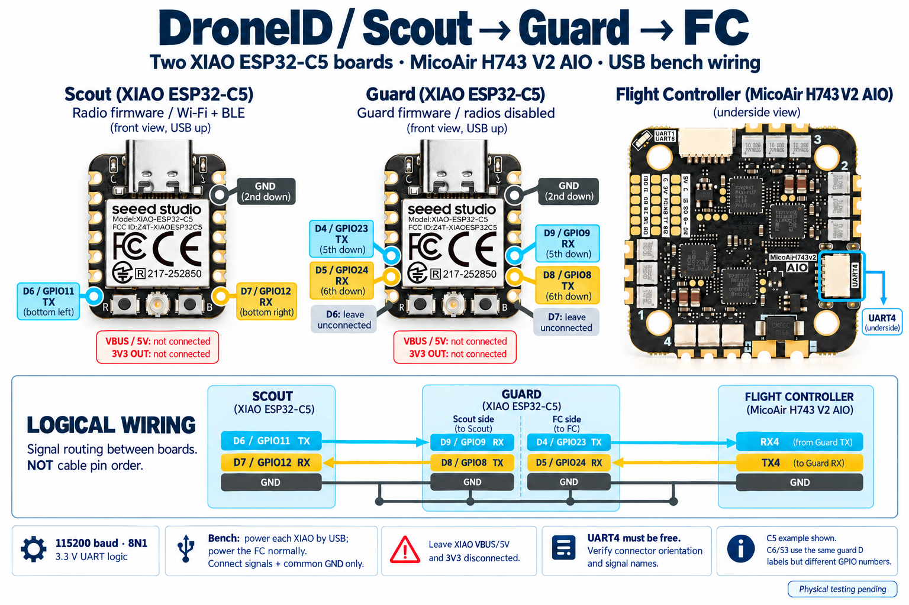

# Independent UART guard — P0 implementation

This is a **separate firmware project for a second XIAO ESP32-C5, ESP32-C6 or ESP32-S3**, inserted
between the radio sensor and the flight controller. The guard has no Wi-Fi/BLE
stack, network service, runtime configuration command or transparent serial
bridge. Its policy is compiled locally; the radio sensor cannot change it.

**Status: guard 0.2.1 builds and offline adversarial tests pass.** The designated
C5 ending `BE:0C:20` has been updated from faulty 0.2.0 and passed USB identity,
build-hash and startup-policy checks; [installation evidence](../threatmodel/evidence/p0-guard-usb-install.json).
The FC/harness is not ready; no FC/harness/power acceptance test has been completed.
P0 is partially closed, pending full validation; resume the [verification plan](../threatmodel/p0-verification-plan.md) and record results in the [P0 closure checklist](../threatmodel/p0-acceptance.md). Direct sensor-to-FC wiring omits this
external guard; use the standalone FC software option for that connection.

This is an **alternative** to the [filter inside the FC](../fc_filter/README.md).
Choose this hardware guard with stock FC firmware, or use one radio XIAO directly
with the custom FC filter. Combining both is optional. See the
[deployment options](../fc_filter/topology.svg).

## Supported XIAO models

The table separates firmware profiles from hardware candidates. **All physical
hardware acceptance is pending**; a successful compile or USB check does not
qualify a board for flight. This research covers the most relevant alternatives,
not the entire XIAO catalog.

| Model | This project | Hardware / porting considerations |
| --- | --- | --- |
| [ESP32-C5](https://wiki.seeedstudio.com/xiao_esp32c5_getting_started/) | Guard 0.2.1 build verified | Existing target; radios present in silicon, stacks excluded |
| [ESP32-C6](https://wiki.seeedstudio.com/xiao_esp32c6_getting_started/) | Guard 0.2.1 build verified | Same pad-label harness; different GPIO mapping; native USB |
| [ESP32-S3 base](https://wiki.seeedstudio.com/xiao_esp32s3_getting_started/) | Guard 0.2.1 build verified | Remove Sense expansion hardware because SD shares D8/D9; Plus variants not qualified |
| [RP2350](https://wiki.seeedstudio.com/xiao_rp2350_arduino/) | Recommended next port candidate; no build yet | No radio hardware; two exposed UARTs, including rear D12 TX / D11 RX; requires Pico SDK/USB port and boot/pin review |
| [RP2040 base](https://wiki.seeedstudio.com/XIAO-RP2040/) | Conditional candidate; no build yet | No radio hardware; one default exposed UART, so a second link needs a reviewed pin-mux/PIO design and timing tests; SDK/USB port required |
| [ESP32-C3](https://wiki.seeedstudio.com/XIAO_ESP32C3_Getting_Started/) | Not supported by this harness | Two UARTs, but D9 is BOOT, D6/D7 are ROM UART and D2–D5 expose external JTAG; requires a separate containment/pin design |

C6/S3 are the closest ports to the current ESP-IDF implementation. RP2350 is our
preferred future radio-free option; this is an engineering assessment based on
the linked pin maps, not a claim that an RP2350 firmware port already exists.
SAMD21, nRF52840, RA4M1 and other families have not been qualified here.
The machine-readable catalog used by the web bench is [boards.json](boards.json).

| Guard function | XIAO pad | C5 GPIO | C6 GPIO | S3 GPIO |
| --- | --- | --- | --- | --- |
| Sensor-facing TX | D8 | 8 | 19 | 7 |
| Sensor-facing RX | D9 | 9 | 20 | 8 |
| FC-facing TX | D4 | 23 | 22 | 5 |
| FC-facing RX | D5 | 24 | 23 | 6 |
| Leave ROM TX/RX unconnected | D6 / D7 | 11 / 12 | 16 / 17 | 43 / 44 |

Both UARTs use 115200 baud, 8N1, 3.3 V signals. GPIO numbers must never be copied
between models. Compile-time assertions forbid either link from using ROM UART
pins. Pins are defined in [main/guard_board.h](main/guard_board.h).

## Connection



[Open the full-size wiring illustration](images/scout-guard-fc.png) ·
[Compact signal-routing SVG](images/wiring.svg) · [Image source and prompt](images/README.md).
The UART4 breakout shows signal names,
not a cable-end pin-order drawing. Confirm pad labels and connector orientation
against the board documentation in the [main wiring guide](../README.md#micoair-h743-v2-aio-example--uart4).

The illustration, table and compact SVG show **C5 GPIO numbers**. C6/S3 use the same pad labels; use their GPIO mappings above.

| From | To | Purpose |
| --- | --- | --- |
| Radio XIAO **D6 / GPIO11 TX** | Guard XIAO **D9 / GPIO9 RX** | Sensor reports into remapped guard UART0 |
| Guard XIAO **D8 / GPIO8 TX** | Radio XIAO **D7 / GPIO12 RX** | Filtered controller telemetry to sensor |
| Guard XIAO **D4 / GPIO23 TX** | MicoAir **RX4** | Guard output into FC UART4 |
| MicoAir **TX4** | Guard XIAO **D5 / GPIO24 RX** | Controller telemetry into guard UART1 |
| Radio GND, guard GND | FC GND | Common signal ground |

**Remove both direct radio-to-FC signal wires.** Only the guard connects to the
FC RX4/TX4 pair. All UARTs are **115200, 8N1, non-inverted, 3.3 V logic**. There
is no RTS/CTS. Guard pins are fixed in `main/guard_board.h`; baud is fixed in `main/guard_main.c`. The C5 has
two full UART controllers; see the [ESP-IDF UART reference](https://docs.espressif.com/projects/esp-idf/en/latest/esp32c5/api-reference/peripherals/uart.html).

For the bench, power each XIAO from its own USB supply and the FC through its
normal bench supply. **Leave the XIAO VBUS/5V and 3V3 pads disconnected from the
FC and from each other.** Common ground is still required. For flight installation,
select and verify regulation/current limiting so a failed sensor or guard cannot
brown out the FC; independent data filtering does not isolate electrical faults.
Do not join USB VBUS and an external 5 V source without a verified power design.

**Leave guard D6/GPIO11 and D7/GPIO12 unconnected.** These are the guard's default
ROM UART pins. Its sensor UART0 is remapped to D8/D9 only after application
startup, keeping both the ROM programming interface and startup banner off the
sensor/FC harness. The FC-facing UART1 uses D4/D5. Do not connect the sensor to
guard BOOT, RESET, JTAG or USB data pins. These mappings use
[Seeed's pin map](https://wiki.seeedstudio.com/xiao_esp32c5_getting_started/#pin-map)
and the SDK's C5 UART pin definitions. No eFuse changes are made; verify actual
reset/download-mode pin behavior as part of hardware acceptance.

## Web bench: flash and test guards

**Use guard 0.2.1 or later.** Version 0.2.0 used a six-byte buffer with an SDK
helper that writes eight bytes on C5/C6. This could corrupt startup memory and
reported the wrong USB identity. Version 0.2.1 requests the six-byte factory MAC
explicitly; the web bench refuses older local builds. Rebuild and reinstall any
0.2.0 guard before acceptance testing. The fix does not qualify the UART or power
installation. See the [P0 acceptance record](../threatmodel/p0-acceptance.md).

Start the [local web bench](../README.md#open-the-web-bench), select a USB device and open
**Device settings**, then choose **Guard**. Scout and guard boards share the device list and per-device
Live log. Operations pause only the selected device’s monitor.

For an isolated host environment with the wired-test dependencies included:

```sh
python3 -m venv .venv
.venv/bin/python -m pip install -r tools/requirements-mavlink.txt
.venv/bin/python ./start-web
```

1. Choose the physical model printed on the board. Native ESP USB VID/PID cannot
   identify a XIAO model; do not infer it from the tty name. For a new board that
   does not appear, hold BOOT, tap RESET, release BOOT to expose its native ROM USB.
2. Build that profile with the command below, then **Refresh devices**. The bench
   verifies the guard project, target, flash layout, image sizes, stack checks and
   absence of radio/network components before offering the build.
3. Disconnect both UART links, select the correct USB serial, and click
   **Install Guard firmware**. This replaces that board’s radio app.
   The server uses an immutable image snapshot and esptool's explicit chip check.
   Post-flash status must match the selected model, version and application ELF
   hash, with readiness and startup self-test passing.
4. **Run USB check** reads two fresh status samples with advancing uptime and the
   same boot session. USB inputs remain discarded by the guard; the server adds
   no management interpreter or passthrough to the guard firmware.
5. Open **Wired UART test** for a six-second physical link smoke test. Install
   `tools/requirements-mavlink.txt` into the server's Python environment. Connect
   two uniquely identified FTDI / CP210x / CH34x / Prolific USB UART adapters,
   refresh, select each adapter and confirm the isolated fixture wiring.

| Fixture connection (radio and FC disconnected) | Guard pad |
| --- | --- |
| Sensor-side adapter TX / RX | D9 / D8 |
| FC-side adapter TX / RX | D5 / D4 |
| Both adapter GNDs | GND |

Use **3.3 V UART logic**, power the guard from USB, and leave both adapters' power
pins disconnected. Adapters without unique USB identity are not offered. Only
one wired fixture job runs at a time; other devices continue monitoring. Close
other programs using either adapter.

The wired test sends uniquely marked benign observations and FC heartbeats,
plus forbidden parameter requests and bad-CRC samples. It checks the DRG2 report
round trip, heartbeat return path, absence of forbidden output, guard rejection
and CRC counters, and no UART errors or restart. Results appear in **Operation
output**; guard status continues in **Live log**. This is a smoke test, not the
full sustained-load, reset, electrical-fault or FC/downlink acceptance procedure.
A USB hash/status match is not cryptographic device attestation.

## Build and provision the guard

In an ESP-IDF terminal, from the repository root:

```sh
python guard/build.py --board xiao_esp32c5
python guard/build.py --board xiao_esp32c6
python guard/build.py --board xiao_esp32s3
```

Build only the profiles you need. Outputs and sdkconfig files are isolated under
`guard/build/<board-id>/`, so changing model cannot silently reuse another target.
The build helper runs `guard/verify_build.py` automatically. To customize trusted
policy IDs, use `python guard/build.py --board xiao_esp32c5 --menuconfig`.

| Setting | Default | Constraint |
| --- | --- | --- |
| Vehicle system | 1 | Match sensor and FC |
| Sensor component | 242 | Match radio module |
| Guard component | 243 | Distinct from sensor, FC and other vehicle components |
| FC component | 1 | Match controller telemetry |
| Destination system/component | 255 / 190 | Match base station; destination system must differ from vehicle; broadcast is forbidden |

IDs 253/254 are excluded because their bytes are MAVLink start markers. Invalid
or colliding configuration leaves forwarding inactive. The guard does not use
NVS and never imports policy from sensor traffic or USB commands.

Identify and label the **guard board's** persistent USB port, then flash only that
board using the separate project (replace the example port):

```sh
idf.py -C guard -B guard/build/xiao_esp32c5 -D SDKCONFIG="$PWD/guard/build/xiao_esp32c5/sdkconfig" -p /dev/serial/by-id/GUARD_BOARD flash monitor
```

Guard USB emits schema-1 status records with `device_type: "uart_guard"`,
`firmware_project: "droneid_guard"`, model, build hash, boot session, uptime, readiness, startup policy self-test and input/output/drop counters.
Its heartbeat represents the **guard**, not verified radio-sensor health.
Counters are local diagnostic evidence, not cryptographic attestation.

Ordinary Scout-flash requests refuse to overwrite a recognized guard. An
intentional conversion is available through **Device settings → Scout → Install
Scout firmware**, and clearly removes this board's guard function. Only a C5 can
run Scout firmware. The server clears the remembered guard role only after a
fresh Scout status verifies the installed version and radio readiness. This is an
accident-prevention check,
not secure boot or device attestation. A board in ROM bootloader mode cannot
announce its role: choose Guard in Device settings, label the board, and do
not select it for the ordinary radio-firmware flash workflow. Physical/host
maintenance compromise remains in the P1 provisioning threat model.

The guard is a new trusted component: a vulnerability in its UART parser or
unauthorized replacement of its firmware can defeat containment. This development
build has no secure-boot provisioning. Its smaller input surface, compiler stack
protection and sanitizer tests reduce exposure; they are not a proof of memory
safety. Deployment provisioning still needs the P1 secure-boot/maintenance work.

## Configure the sensor, controller and base station

1. Keep the normal radio firmware on the sensor. Enable its UART at 115200,
   TX GPIO11 / RX GPIO12, system 1, component 242, expected FC component 1,
   destination 255/190. Set maximum observations to 5/s. Adapt IDs together
   if the guard's compiled policy differs.
2. Configure the FC UART4 for MAVLink 2 using the existing
   [ArduPilot](../README.md#ardupilot-on-the-micoair--uart4--serial4) or
   [iNav](../README.md#inav-on-the-micoair--uart4-bench-input) instructions.
   In those instructions, the physical peer on UART4 is now the **guard**.
   The [FC ingress patches](../fc_filter/README.md) are optional in this external-guard
   deployment; the second XIAO enforces the policy before stock FC firmware.
   Preserve the vehicle's existing
   signing requirements: this prototype accepts/emits unsigned MAVLink 2 only.
   A link requiring signed frames needs an explicit compatible guard policy;
   weakening vehicle authentication is not part of this setup.
3. Use the updated `tools/mavlink_receiver.py` on the base station. Normal radio
   reports arrive from component **243**, with the original sensor's receiver
   ID/session/raw RID inside. The guard never impersonates the FC or forwards
   the sensor's chosen MAVLink envelope. A received `DRG2` marker alone does
   not prove a genuine guard sent it.
4. Confirm ArduPilot learns the base-station route through its existing downlink.
   The guard does not relay GCS commands/heartbeats back to the sensor. With the
   FC filter installed, accepted TUNNEL reports teach ArduPilot the guard route;
   its heartbeat is consumed without entering normal FC handlers. **The guard does not add an
   iNav TUNNEL-forwarding capability.** An iNav return path still needs a gateway
   or FC extension, as described in the integration guide.

For the existing serial/UDP receiver example:

```sh
python tools/mavlink_receiver.py --connect udpin:127.0.0.1:14550
```

No new host dependency is needed for the wrapper decoder. RID remains marked
`authentication: "unverified"`; `wire_encoding: "drg2_base64"` describes the
format only. Reporter authentication and aircraft authentication remain separate
P1 requirements.

## Enforced policy

| Boundary | Allowed behavior | Everything else |
| --- | --- | --- |
| Sensor → guard | Correct-source unsigned MAVLink 2 heartbeat; TUNNEL type 0 to the fixed base-station destination, with exact DRID v1 observation/health sizes and valid metadata | Reject, including arbitrary commands, missions, parameters, RC, FTP, broadcast destinations, flags, malformed CRC and hidden payload suffixes |
| Guard → FC | Regenerated fixed non-autopilot heartbeat; validated observations/health in the DRG2 encoding, fixed IDs/destination and new sequence/CRC | No raw passthrough or partially validated output |
| FC → sensor | Correct-source unsigned MAVLink 2 HEARTBEAT, GLOBAL_POSITION_INT and GPS_RAW_INT; position/GPS require recent FC heartbeat and bounded fields | Reject other message types/sources/flags; no remote sensor configuration |
| USB → guard application | Consume/discard input; periodic diagnostics only | No configuration parser, forwarding or application flash trigger |

Raw RID is intentionally not interpreted as commands or authenticated identity.
The guard validates outer shape and metadata. False but well-formed aircraft
claims can still reach the operator. The original sensor-to-guard source IDs
are format policy, not secrets.

| Resource | Independent guard limit |
| --- | --- |
| Input work per side | At most 128 bytes per 10 ms loop and 4,096 bytes/s with a 512-byte burst budget; discarded fragments reset parsing |
| Input UART storage | 512 bytes and 16 queued events per UART; bounded event draining |
| Pending reports | Latest observation + latest health; latest FC heartbeat + position + GPS; no dynamic policy allocation |
| Pending lifetime / partial-frame gap | 2 seconds / 100 ms |
| FC-bound message periods | Heartbeat ≥1 s, observation ≥200 ms, health ≥2 s |
| FC-bound byte budget | 800 bytes/s with a 160-byte burst allowance, including framing |
| Sensor-bound message periods | FC heartbeat ≥1 s; position/GPS each ≥500 ms |
| Sensor-bound byte budget | 500 bytes/s with a 160-byte burst allowance |
| UART output stall | Nonblocking writes; abandon unfinished frame after 250 ms |

Rates are ceilings, not delivery guarantees. Overload coalesces or drops data.
Source counters inside health are still sensor claims; guard USB has separate
drop/rejection counters. Guard `output_frames`/`output_bytes` count complete
frames released by the policy, not successful FC receipt; UART errors are
reported separately and the link has no delivery acknowledgment. Hardware ISR cost and FC/control-link latency remain
to be measured. The guard preserves format validity and limits traffic but does
not guarantee reception, prevent jamming, or authenticate a compromised sensor.

## Why reports use DRG2

MAVLink's TUNNEL payload can contain arbitrary bytes. If the FC parser restarts
mid-frame, those bytes could include a complete nested MAVLink frame. Checking
only the original outer frame is insufficient for that loss-of-boundary case.
The guard encodes the entire existing 78/84-byte DRID record as canonical Base64,
prefixed with ASCII `DRG2`, inside TUNNEL. The resulting payload is 108/116 bytes.

Every FC-bound frame contains **no `0xFD` or `0xFE` after its initial `0xFD`**.
The guard fixes header fields and selects a sequence/CRC that also avoids those
start bytes, with a bounded search that fails closed. Therefore, starting a
fresh MAVLink parser at any interior byte cannot discover a nested frame; it
must wait for the next real frame start. This property applies to the guard's
emitted bytes on an intact guard-to-FC wire. It does not protect against an
attacker electrically injecting on that wire, arbitrary bit corruption, or a
bug in the downstream parser. See [MAVLink serialization](https://mavlink.io/en/guide/serialization.html).

The original record is preserved byte-for-byte after decoding. Do not unpack
its raw RID into a MAVLink command stream. Applications that modify or re-encode
guard frames on the FC ingress path need a new review of this property.

## Validation and remaining acceptance

Run the repository suite with the optional reference decoder installed:

```sh
python -m pip install -r tools/requirements.txt -r tools/requirements-mavlink.txt
bash tests/run_host_tests.sh
```

The guard C suite runs under ASan/UBSan. It rejects every other message type in
the pinned common dialect, exercises schema/CRC/flag/truncation failures, source
and direction filtering, overload budgets, expiry and recovery, and tests parser
restart at every byte of an adversarial embedded-frame report. Random-stream
trials feed both sides. Python/pymavlink independently decodes C-generated frames
and verifies the original observation/health fields. See the
[implementation evidence](../threatmodel/evidence/p0-implementation.json).

The [guard-bench evidence](../threatmodel/evidence/guard-bench.json) records
three target builds, host tests, mocked wired-fixture tests and desktop/mobile
browser checks. The browser smoke test is repeatable with Playwright/Chromium
and all three local builds: `python tests/check_guard_ui.py`. It intercepts every
request and uses simulated devices, with no serial-port access.

P0 is **not closed for flight deployment** until these results are recorded:

- Exact installed FC build/target/configuration; real route and guard-harness
  verification, including removal of direct sensor-to-FC wires.
- Isolated simulator/bench demonstration that forbidden frames never change
  FC mode, mission or parameters, and that the selected downlink preserves the
  new TUNNEL records. The offline parser tests do not substitute for FC tests.
- Sustained full-line-rate traffic, disconnect/reconnect, guard/sensor reset and
  mid-frame restart tests with measured FC/control-link latency and watchdog behavior.
- Guard and sensor supply margin/current limiting, power sequencing, startup
  pin behavior and fault isolation on the actual harness. No shared-rail fault
  test has been performed; TM-11 remains open.

For a deployment that cannot add a guard yet, physically omitting sensor TX →
FC RX removes that direct serial injection path; observations then need USB or
a separate reporting path. A software UART-disable setting alone is insufficient.
