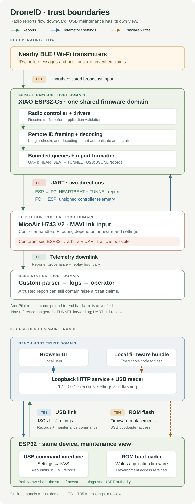

# DroneID threat model

**Review: 2026-10-24 · firmware 0.5.0 · XIAO ESP32-C5 · development build**

The device is an **untrusted-radio sensor with a connection to a flight controller**.
Its reports are useful observations, but currently provide no authenticated
friend-or-foe classification. A radio attacker can mislead or overwhelm the
receiver without taking over its firmware. If the ESP32 itself is compromised,
the direct UART transmit connection becomes a potential route into the flight
controller. There is no independent command filter on that path in this project.

## Direct answers

| Question | Current assessment | Evidence |
| --- | --- | --- |
| Can someone connect to the ESP32 over Wi-Fi or BLE and log in? | No application Wi-Fi network service, connectable BLE service, provisioning service, or OTA updater is enabled in the reviewed firmware. Receiving broadcasts still exposes radio drivers and parsers. | Source review: [TM-03](threat-register.md#tm-03--radio-parser-or-stack-compromise) |
| Can someone interfere over the air? | **Yes.** Forged/replayed IDs, messages and positions, contact-table flooding, and RF interference can corrupt the picture or hide legitimate traffic. | [TM-01](threat-register.md#tm-01--forged-and-replayed-aircraft-claims), [TM-02](threat-register.md#tm-02--reception-and-resource-denial-of-service) |
| Can a radio packet take over the ESP32? | **Possible if a reachable parser/driver vulnerability exists; none demonstrated in this review.** The application is bounded in several places, but host tests do not exercise the vendor radio firmware or prove memory safety. | [TM-03](threat-register.md#tm-03--radio-parser-or-stack-compromise) |
| Can an ID or hello message directly become a flight command? | No such path was found in the current application. Raw Remote ID bytes remain data inside a fixed MAVLink `TUNNEL` envelope. A boundary probe confirms this for an embedded benign MAVLink frame. | [TM-04](threat-register.md#tm-04--compromised-esp32-pivots-into-the-flight-controller), [checks](validation.md#offline-boundary-probes) |
| Could a compromised ESP32 interfere with the FC? | **Yes, potentially.** It controls the UART TX wire and could send arbitrary frames or saturate it. Command acceptance and flight effects depend on the exact FC firmware, port settings, signing policy and vehicle state. No FC compromise was tested. | [TM-04](threat-register.md#tm-04--compromised-esp32-pivots-into-the-flight-controller) |
| Can the bench or operator software be attacked through the device? | Yes: USB and forwarded records are additional trust boundaries. A malformed USB status record reproducibly escapes the bench reader with an exception and poisons its JSON state. | [TM-07](threat-register.md#tm-07--malformed-usb-record-breaks-bench-monitoring) |

The first architectural priority is to **constrain the ESP32's authority at a
boundary it cannot modify**. A filter inside the same ESP32 firmware is useful
against bad input, but cannot contain firmware takeover.

## Documents

- [Threat register](threat-register.md): attack conditions, existing controls, impact and gaps.
- [Hardening plan](hardening-plan.md): priorities and measurable acceptance criteria.
- [Validation and sources](validation.md): reproduction commands, evidence, scope limits and open questions.
- [Baseline snapshot](evidence/baseline.json): reviewed source/build fingerprints and security configuration.
- [Offline probe results](evidence/boundary-checks.jsonl): observed properties and weaknesses, not a security certification.

## Scope and intended security properties

The intended function is to log nearby aircraft claims and send observations to
an operator through the vehicle's telemetry system. Reports must not authorize
flight actions. The example controller is a MicoAir H743 V2 AIO, with ArduPilot
or iNav; the actual installed controller and downlink remain unverified.

This review covers the application radio parsers and codecs, ESP-IDF build
configuration, USB configuration/monitoring, UART framing, local web bench,
firmware loading, and the supplied base-station decoder. It examines pinned FC
source examples to understand the integration boundary. It is not a complete
audit of ESP-IDF, controller firmware, the operating system, the browser, the
radio link to the base station, or future custom operator software.

| Asset | Required property |
| --- | --- |
| Flight controller and flight-control availability | A sensor must not acquire command, mission, parameter, RC, or firmware authority; sensor failure must not exhaust FC resources or destabilize its supply. |
| Aircraft observations | Preserve raw evidence and provenance; distinguish a claimed identity from a verified identity; expose loss, age and receiver degradation. |
| ESP32 firmware and configuration | Only authorized maintenance changes persistent identity, role, UART settings and executable code. |
| Operator host and base station | Treat device/radio records as hostile input; isolate a failing device; keep UI, logs and parsers available. |
| Keys and operational information | Keep command-authorizing secrets off the radio sensor where possible; treat broadcast hello messages as public; control access to logs. |

## Data flows and trust boundaries

[Open the full-size SVG](images/data-flows-trust-boundaries.svg).
Read the operating flow from top to bottom. The lower maintenance view shows
the **same ESP32**, with USB records, configuration and firmware replacement
drawn separately. Arrowheads show direction; outlined panels identify trust
domains, and TB1–TB5 retain the original boundary identifiers.

The diagram shows the ArduPilot routing concept, not verified end-to-end
hardware behavior. The reference iNav implementation has no general TUNNEL
forwarder. It nevertheless reads incoming MAVLink on its telemetry port; see
[the controller-specific analysis](threat-register.md#tm-04--compromised-esp32-pivots-into-the-flight-controller).

The normal `TUNNEL` writer is a format boundary, not a hardware isolation
boundary. Radio tasks, USB commands and UART transmission share one firmware
trust domain. An application-level UART disable flag does not constrain an
attacker already executing code on the ESP32.

## Attacker positions

| Attacker | Access assumed | Relevant threats |
| --- | --- | --- |
| Nearby radio transmitter | Can send well-formed or malformed broadcasts, vary addresses/power, replay captured traffic or interfere with airtime; no pairing or Wi-Fi association needed. | TM-01–03 |
| Compromised/captured ESP32 | Can change firmware or execute code, drive available pins, fabricate reports and use the attached UART. | TM-04, TM-06–08, TM-11 |
| UART/downlink participant | Can inject traffic on that link; does not automatically have a signing key or FC authorization. | TM-05–06 |
| Malicious web page | Runs in a normal browser with normal same-origin restrictions. Distinct from a local process. | TM-09 |
| Local host process or maintenance attacker | Can reach the loopback service; stronger variants can access serial ports, modify build artifacts or operate BOOT/RESET. | TM-07–10 |

## Current stance

The implementation has useful defensive foundations: strict radio framing,
fixed-size messages, bounded queues and logs, a rate-limited UART worker,
escaped UI text, local-only HTTP binding and browser request guards. There is
no discovered direct path from a hello string to a shell, persistent setting,
or flight command.

The outstanding architectural gaps are **unauthenticated aircraft claims,
uncontained authority over the FC UART after ESP32 compromise, and an unlocked
development maintenance model**. Successful host tests do not resolve those
gaps. The [hardening plan](hardening-plan.md) defines what to change and verify
before relying on the module in a hostile operating environment.
